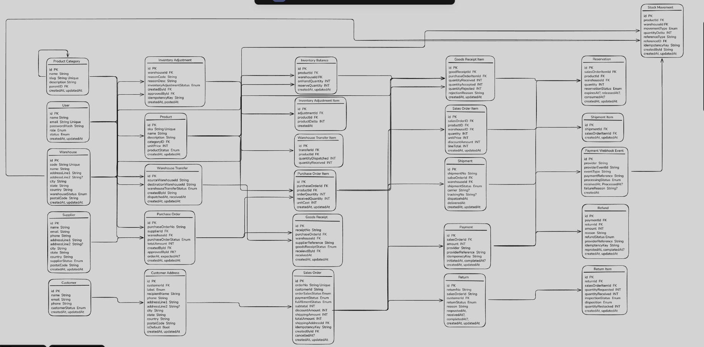

# Inventory Management System

A backend inventory management system for products, categories, suppliers, warehouses, purchasing, sales, stock movement, and authentication.

## Database Design



## Documentation

- [Software Requirements Specification](docs/01-SRS.md)
- [API Specification](docs/02-API-Specification.md)

## Tech Stack

- Bun
- TypeScript
- Express
- PostgreSQL
- Prisma

## Getting Started

1. Go to the API directory:

   ```bash
   cd api
   ```

2. Install dependencies:

   ```bash
   bun install
   ```

3. Configure the environment variables in `api/.env`.

4. Start the development server:

   ```bash
   bun run dev
   ```

The API runs on port `8000` by default.

## Available Commands

```bash
bun run start       # Start the server
bun run typecheck   # Check TypeScript types
bun run test        # Run tests
```
